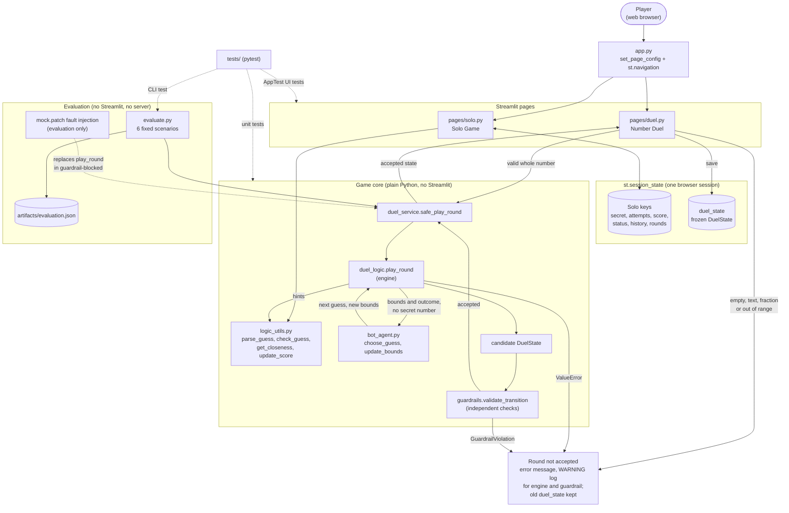

# Number Duel

Number Duel is a Streamlit app with two separate games:

- **Solo Game**: guess the hidden number before your attempts run out.
- **Number Duel**: you and the computer opponent **Vector** each pick a
  secret number and race to guess the other's number, one guess each per
  round.

Vector is a **deterministic binary-search algorithm**, not an AI model.
The advanced part of this project is a **built-in reliability system**:
every round of the duel is checked by an independent inspector before the
new game state is saved.

> **What this project does not use:** no external AI API, no trained
> model, no language model and no RAG. The Solo game does not go through
> the duel inspector.

## Contents

- [Base Project](#base-project)
- [Pages](#pages)
- [New features and fixes](#new-features-and-fixes)
- [How a duel round works](#how-a-duel-round-works)
- [Reliability system](#reliability-system)
- [Architecture](#architecture)
- [Setup](#setup)
- [Running the app, tests and evaluation](#running-the-app-tests-and-evaluation)
- [Evaluation](#evaluation)
- [Design decisions and trade-offs](#design-decisions-and-trade-offs)
- [Results and limits of testing](#results-and-limits-of-testing)
- [Known limitations](#known-limitations)
- [Project structure](#project-structure)
- [Documentation and AI collaboration](#documentation-and-ai-collaboration)

## Base Project

This project started from **"Game Glitch Investigator: The Impossible
Guesser"**. It was a Streamlit number guessing game that came with bugs on
purpose: the player picked a difficulty, guessed a secret number and got
"higher / lower" hints, a score and a limited number of attempts. The hints
were reversed, the secret was compared as text on every second attempt,
and the attempts counter started at the wrong number, so the game could
not be won.

During the base project the bugs above were fixed, the game logic was
moved into `logic_utils.py` and covered with pytest tests, and the game
got Hot / Warm / Cold hints, colored hint boxes, a guess history and a
summary table. The final project builds Number Duel on top of that.

## Pages

| Page | What you do | Ranges and limits |
|------|-------------|-------------------|
| **Solo Game** | Guess the hidden number. Each guess gets a hint (higher / lower) and a closeness label: Hot (at most 5 away), Warm (at most 15 away) or Cold. The page shows the score and a guess history, and a summary table when the game ends. | Easy 1-20, 6 attempts · Normal 1-100, 8 attempts · Hard 1-50, 5 attempts |
| **Number Duel** | Pick your secret number, then play rounds against Vector. In every round you guess Vector's number and Vector guesses yours. Two cards show the last guess and hint of each side, and a table shows the whole history. | Same ranges; Easy 6, Normal 8, Hard 5 rounds |

The pages are separate: each keeps its own state, and switching between
them does not reset either game.

## New features and fixes

### New features

- **Two pages** with `st.navigation`: Solo Game and Number Duel.
- **Number Duel** against Vector, a deterministic binary-search bot
  (`bot_agent.py`, `duel_logic.py`).
- **Reliability system**: an independent inspector
  (`guardrails.py`) checks every duel step, and a safe service
  (`duel_service.py`) accepts a round only after the check passes.
- **Logging** of accepted and rejected rounds, without secrets.
- **Reproducible evaluation script** (`evaluate.py`) with six fixed
  scenarios and a JSON report.
- **Dark arena theme** shared by both pages (`.streamlit/config.toml`,
  `ui_style.py`).
- **New Duel** is available during a duel and after it ends.

### Fixes to the Solo game

- New Game now resets the status, score and history. Before, it kept
  saying "You already won".
- New Game picks the secret from the selected difficulty's range instead
  of always 1-100.
- The prompt shows the selected range instead of a fixed "1 and 100".
- Changing the difficulty starts a new game.
- Empty or non-numeric input no longer uses up an attempt.
- The Developer Debug Info panel was removed, because it showed the
  secret during the game.
- Switching to Number Duel and back keeps the solo game and its
  difficulty.

## How a duel round works

1. **Start**: you choose a difficulty and enter your secret number.
   Vector's secret is drawn with `random.randint` only at this moment.
2. **Your move**: your guess is compared with Vector's secret
   (Too Low, Too High or Win).
3. **Vector's move**: Vector always guesses the middle of the numbers that
   are still possible (`choose_guess`). Its guess is compared with your
   secret, and its search range is narrowed (`update_bounds`). The bot
   functions only receive the range bounds and the hint, never your secret
   number.
4. **Result**, decided after both moves:
   both guessed right → draw; only you → you win; only Vector → Vector
   wins; nobody, but the round limit is reached → draw; otherwise the duel
   goes on.

Vector's number is shown only after the duel ends.

## Reliability system

Every duel round goes through `duel_service.safe_play_round`:

1. The engine (`duel_logic.play_round`) builds a **candidate** state. The
   game state is immutable (frozen dataclasses), so the old state is never
   changed.
2. The inspector (`guardrails.validate_transition`) checks the step from
   the old state to the candidate.
3. Only if the check passes is the candidate returned. The duel page then
   saves it as `duel_state`.

The inspector does **not** call the game functions (`check_guess`,
`play_round`, `choose_guess`, `update_bounds`). It works everything out
again with its own number comparisons:

- **Structure**: correct types, the duel was still running and had
  attempts left, settings and secrets kept their value and type, exactly
  one new round, earlier rounds unchanged.
- **Guesses and hints**: both guesses are whole numbers inside the range,
  and both hints match the secrets.
- **Vector's range**: it is rebuilt from the whole history and must match
  the stored range before and after the round; every Vector guess must lie
  inside the range it had at that time.
- **Result**: the status is worked out again from the history, and no round
  may follow a round that ended the duel.

When a round is rejected:

- bad input (empty, text, fractions, out of range) gets a clear message
  and does not use up a round;
- an engine error (`ValueError`) is passed on unchanged;
- an inspector rejection becomes a `GuardrailViolation`. The player sees
  only a general message, never the inner reason;
- the log shows `duel_round_rejected` with `stage=engine` or
  `stage=guardrail`, and the old `duel_state` stays as it was.

## Architecture

| Module | Role |
|--------|------|
| `app.py` | Page config and navigation between the two pages |
| `pages/solo.py` | Solo Game page |
| `pages/duel.py` | Number Duel page (setup, rounds, result, New Duel) |
| `ui_style.py` | Shared dark arena styles and the duel player cards |
| `logic_utils.py` | Solo rules: input parsing, hints, closeness, score |
| `bot_agent.py` | Vector's strategy: `choose_guess`, `update_bounds` |
| `duel_logic.py` | Duel state (`DuelState`, `DuelRound`), `create_duel`, `play_round` |
| `guardrails.py` | Independent inspector `validate_transition` |
| `duel_service.py` | `safe_play_round`, `GuardrailViolation`, logging |
| `evaluate.py` | Reproducible evaluation of six duel scenarios |

Mermaid source: [diagrams/architecture.mmd](diagrams/architecture.mmd)



## Setup

Requirements: Python 3 and the packages in
[requirements.txt](requirements.txt) (`streamlit>=1.36.0`, `altair<5`,
`pytest`).

```bash
python3 -m venv .venv
source .venv/bin/activate        # Windows: .venv\Scripts\activate
pip install -r requirements.txt
```

**Tested environment:** Python 3.13.15 and Streamlit 1.60.0.

## Running the app, tests and evaluation

```bash
# The app (opens at http://localhost:8501)
python -m streamlit run app.py

# All automated tests
python -m pytest -q

# All six evaluation scenarios
python evaluate.py

# One scenario
python evaluate.py --case guardrail-blocked

# All scenarios, plus a JSON report
python evaluate.py --output artifacts/evaluation.json
```

`evaluate.py` exits with code 0 when every selected scenario passed and 1
when any scenario failed.

## Evaluation

`evaluate.py` runs fixed scenarios through the real `create_duel` and
`safe_play_round`, without Streamlit or a server. All numbers are **fixed
synthetic test data** in the range 1-100. The report has no times or random
values, so every run gives the same report.

| Scenario | Your secret | Vector's secret | Round limit | Your guesses | Expected |
|----------|-------------|-----------------|-------------|--------------|----------|
| `player-win` | 63 | 27 | 8 | 40, 27 | `player_won` |
| `bot-win` | 50 | 27 | 8 | 40 | `bot_won` |
| `simultaneous-win` | 50 | 27 | 8 | 27 | `draw` |
| `limit-draw` | 63 | 27 | 1 | 40 | `draw` |
| `invalid-input` | 63 | 27 | 8 | 101 | engine `ValueError`, state unchanged |
| `guardrail-blocked` | 63 | 27 | 8 | 40 | `GuardrailViolation`, state unchanged |

In `guardrail-blocked`, the script builds a correct result for guess 40,
changes its status to `player_won`, and uses a temporary `mock.patch` so
that the engine returns this wrong result. The real inspector stays on.
This fault injection exists only in the evaluation; the app has no such
switch.

A **trace** shows what the algorithm actually did in each accepted round:
both guesses, both hints, Vector's range before and after, and the
guardrail decision. It is a record of a deterministic algorithm, not hidden
reasoning of a language model.

The examples below are copied from the saved real runs in
[artifacts/execution_examples.txt](artifacts/execution_examples.txt). The
full JSON report is in
[artifacts/evaluation.json](artifacts/evaluation.json).

### Example: player-win

```text
$ .venv/bin/python evaluate.py --case player-win
Number Duel evaluation
Note: All numbers are fixed synthetic test data (range 1-100).
Note: Traces show observed moves of the deterministic binary-search bot and guardrail decisions, not hidden reasoning of a language model.

[1/1] player-win
  input:    player_secret=63, bot_secret=27, attempt_limit=8, guesses=[40, 27]
  expected: status='player_won'
  log:      INFO duel_service duel_round_accepted round=1 status=playing
  log:      INFO duel_service duel_round_accepted round=2 status=player_won
  trace:
    round 1: you 40 -> Too High | Vector 50 -> Too Low | bot range 1-100 -> 51-100 | guardrail: accepted | status: playing
    round 2: you 27 -> Win | Vector 75 -> Too High | bot range 51-100 -> 51-74 | guardrail: accepted | status: player_won
  actual:   status='player_won', rounds=2
  check:    [ok] status is player_won
  check:    [ok] one accepted round per guess
  result:   PASS

passed: 1  failed: 0  total: 1
[exit code: 0]
```

### Example: simultaneous-win

```text
$ .venv/bin/python evaluate.py --case simultaneous-win
Number Duel evaluation
Note: All numbers are fixed synthetic test data (range 1-100).
Note: Traces show observed moves of the deterministic binary-search bot and guardrail decisions, not hidden reasoning of a language model.

[1/1] simultaneous-win
  input:    player_secret=50, bot_secret=27, attempt_limit=8, guesses=[27]
  expected: status='draw'
  log:      INFO duel_service duel_round_accepted round=1 status=draw
  trace:
    round 1: you 27 -> Win | Vector 50 -> Win | bot range 1-100 -> 50-50 | guardrail: accepted | status: draw
  actual:   status='draw', rounds=1
  check:    [ok] status is draw
  check:    [ok] one accepted round per guess
  result:   PASS

passed: 1  failed: 0  total: 1
[exit code: 0]
```

### Example: guardrail-blocked

```text
$ .venv/bin/python evaluate.py --case guardrail-blocked
Number Duel evaluation
Note: All numbers are fixed synthetic test data (range 1-100).
Note: Traces show observed moves of the deterministic binary-search bot and guardrail decisions, not hidden reasoning of a language model.

[1/1] guardrail-blocked
  input:    player_secret=63, bot_secret=27, attempt_limit=8, guess=40, fake_status='player_won'
  expected: exception='GuardrailViolation', state_unchanged=True, rounds=0
  log:      WARNING duel_service duel_round_rejected round=1 stage=guardrail
  actual:   exception='GuardrailViolation', message='The game produced an invalid round, so it was not accepted.', inspector_reason="after.status is 'player_won', expected 'playing'.", engine_calls=1, state_unchanged=True, rounds=0, patch_removed=True
  check:    [ok] GuardrailViolation raised
  check:    [ok] real inspector gave the reason
  check:    [ok] patched engine was called once
  check:    [ok] state unchanged
  check:    [ok] no round added
  check:    [ok] patch removed after the case
  result:   PASS

passed: 1  failed: 0  total: 1
[exit code: 0]
```

## Design decisions and trade-offs

- **A deterministic bot instead of an AI service.** Vector works without
  API keys or a network, and every run is reproducible and testable. The
  trade-off is that Vector is fully predictable.
- **An inspector that does not trust the engine.** The inspector works out
  hints, ranges and the result on its own, so an engine bug cannot hide
  behind the engine's own functions. The trade-off is that the game rules
  exist twice and must be kept in sync.
- **Immutable state and "check before save".** Each round makes a new
  `DuelState`, so the old state can always be compared with the candidate
  and stays intact when a round is rejected.
- **A general error message for the player.** The player never sees the
  inspector's inner reason. Developers can still find it in the exception's
  cause and in the log stage.
- **Separate input rules per game.** The duel accepts only whole numbers
  and rejects fractions. The Solo game keeps the base project's
  `parse_guess`, which cuts a decimal like 3.7 down to 3.
- **Theme applied in each page.** Streamlit 1.60 removes `<style>` from
  `st.markdown`, and elements drawn by `app.py` only stay on the default
  page. So each page calls `apply_theme()`, which uses `st.html`. The CSS
  uses Streamlit's `data-testid` attributes, which can change between
  versions.

## Results and limits of testing

Last confirmed results, on Python 3.13.15 with Streamlit 1.60.0:

- **119 automated tests passed** (`python -m pytest -q`);
- **6 of 6 evaluation scenarios passed** (`python evaluate.py`).

These are two different measures, and neither is a guarantee that the app
has no bugs.

What the tests cover:

- unit tests for every game module, including negative tests that check
  each inspector rule rejects a broken step for the right reason;
- the safe service and its logs;
- the pages through Streamlit's `AppTest`: page switching keeps both
  games, bad input does not use up a round, a broken engine result is
  blocked without an error in the page, Vector's secret is not shown during
  the duel, and New Duel does not change the Solo game;
- the evaluation script through a real command-line run, including a
  check that two runs give the same JSON.

Limits of this testing:

- the evaluation uses six fixed, hand-picked scenarios, not random or
  exhaustive data;
- `AppTest` does not render a real browser. The look of the pages was
  checked with browser screenshots during development; there are no
  automated visual tests;
- only Python 3.13.15 and Streamlit 1.60.0 were tested. Streamlit 1.36 is
  the declared minimum, but it was not tested;
- there are no load or multi-user tests.

## Known limitations

- **Vector is predictable.** Anyone who knows binary search knows its next
  guess. On Easy and Normal it always finds your number within the round
  limit (at most 5 and 7 guesses); on Hard it needs up to 6 guesses but
  has only 5 rounds, so it cannot find 19 of the 50 possible numbers in
  time.
- **The inspector checks that Vector's guess is inside its range**, not that
  it is exactly the middle.
- **State lives only in the current browser session.** Reloading the
  browser tab or restarting the server starts both games over; nothing is
  saved to disk.
- **The engine knows both secrets** to decide the hints. Vector's strategy
  functions do not get your secret, but anyone who runs the server can read
  the session state or change the code. There is no protection against
  cheating by whoever controls the server.
- **Solo is not inspected.** Only duel rounds go through the inspector.
- **Solo scoring keeps a rule from the base project:** a "Too High" guess
  on an even attempt adds 5 points instead of taking 5 away.

## Project structure

```text
app.py                 navigation and page config
pages/solo.py          Solo Game page
pages/duel.py          Number Duel page
ui_style.py            shared styles and duel player cards
logic_utils.py         Solo game rules
bot_agent.py           Vector's binary-search strategy
duel_logic.py          duel state, create_duel, play_round
guardrails.py          independent inspector validate_transition
duel_service.py        safe_play_round, GuardrailViolation, logging
evaluate.py            reproducible evaluation script
tests/                 pytest tests (unit, AppTest UI, CLI)
artifacts/             saved evaluation report and real command output
diagrams/              Mermaid architecture source
assets/                folder kept for project images
.streamlit/config.toml dark theme
```

## Documentation and AI collaboration

- [model_card.md](model_card.md): how the system works, its limits,
  testing and the role of AI in building it.
- [ai_interactions.md](ai_interactions.md): decisions made while working
  with the AI agent, the observed `player-win` trace and the blocked
  example, plus the base project's history.
- [reflection.md](reflection.md): reflection from the base project.
